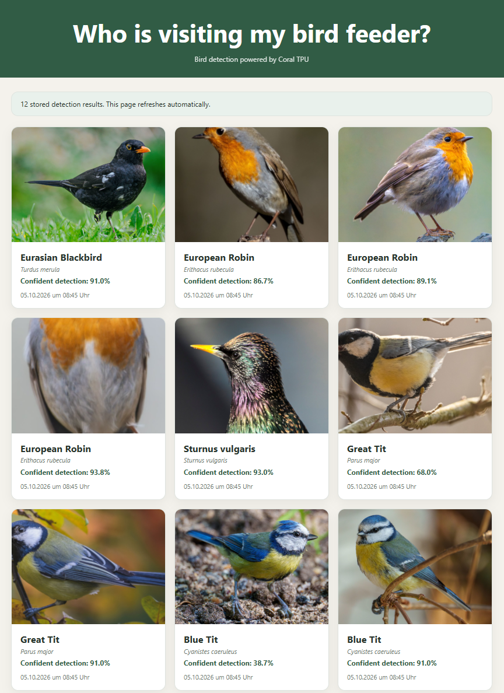

TL;DR Lightweight bird feeder monitoring system powered by Google Coral TPU.

Birdfeeder captures snapshots from one or more RTSP cameras, detects birds,
classifies species, stores observations as JSON records, and provides a simple
Flask-based web interface for browsing observations and image crops.

# Birdfeeder

Lightweight bird feeder monitoring powered by Google Coral TPU.

Birdfeeder captures images from one or more RTSP cameras, detects birds using a
Google Coral Edge TPU through CoralAPI, classifies bird species, stores
observations as JSON records, and presents the results through a lightweight
Flask web interface.

The project follows a strong KISS (Keep It Simple, Stupid) philosophy and was
created as a lightweight alternative to more complex bird-monitoring stacks.

---

## Birdfeeder Web Interface

A lightweight local web interface showing detected birds, confidence scores, translated species names and cropped observations.



---

## Features

- RTSP camera integration
- Sequential multi-camera processing
- Coral TPU accelerated object detection
- Bird species classification
- Automatic crop generation
- Accepted and uncertain observations
- JSON-based observation history
- Automatic retention management
- Observation detail pages
- Manual observation deletion
- Per-camera statistics
- Storage usage statistics
- Lightweight Flask web interface
- Multi-language user interface (English / German)
- Localized bird names
- Scientific bird names
- Health endpoint
- Docker-based deployment
- No database required
- Low resource consumption
- Fully self-hosted

---

## Architecture

```text
RTSP Cameras
      │
      ▼
birdfeeder
      │
      ├── CoralAPI → Google Coral Edge TPU
      │
      └── /srv/birdfeeder
              │
              ├── birdfeeder-web
              └── birdfeeder-retention
```
---

## Requirements

### Hardware

- One or more RTSP-compatible IP cameras
- Google Coral Edge TPU (USB, PCIe or M.2)
- Linux host

### Software

- Docker
- Docker Compose
- CoralAPI
- Python 3.12 (for local development)

---

## Quick Start

Create a local configuration:

```bash
cp .env.example .env
nano .env
```

Build the shared image:

```bash
docker compose build birdfeeder
```

Start all services:

```bash
docker compose up -d
```

Open the WebUI:

```text
http://SERVER-IP:8080
```

---

## Documentation

Detailed documentation is available in the `docs` directory.

| Document | Description |
|-----------|-------------|
| CAMERAS.md | Camera configuration and multi-camera runtime |
| CORAL.md | CoralAPI and Coral TPU integration |
| DEPLOYMENT.md | Deployment, operations and maintenance |

---

## Design Philosophy

Birdfeeder intentionally avoids unnecessary complexity.

Goals:

- Self-hosted
- Lightweight
- Easy to understand
- Easy to maintain
- Few dependencies
- No database requirement
- Human-readable JSON data

The project replaces a significantly more complex setup consisting of:

- Frigate
- WhoIsAtMyFeeder sidecar
- go2rtc
- WatchMyBirds

while keeping the functionality required for bird feeder monitoring.

---

## Roadmap

### v0.6.x
- Species analytics
- Long-term activity trends
- Additional dashboard insights
- Advanced observation search

---

## AI Usage Notice

> This project was initially bootstrapped using AI-assisted tools ("vibe coding") and subsequently reviewed, refactored, tested, and documented manually to ensure maintainability, transparency, and operational reliability.

---

## License

This project is licensed under the GNU General Public License v3.0 (GPL-3.0).

You are free to use, modify and redistribute this software under the terms
of the GPL.

See the LICENSE file for details.

---

## Demo Images and Testing

The web interface screenshot shown in this repository was generated using publicly available bird photographs from Pexels.

The same images were also used during development and testing of Birdfeeder's species classification and user interface.

Photographers credited:

- cosy1337
- dkomov
- Ganajp
- Hemant Goyal
- Lichtblick800
- Olympus
- Valentin

Many thanks to the photographers for providing freely usable reference images that helped with Birdfeeder testing, validation and documentation.

Photo licensing and attribution information can be found on Pexels:
https://www.pexels.com/license/

---
